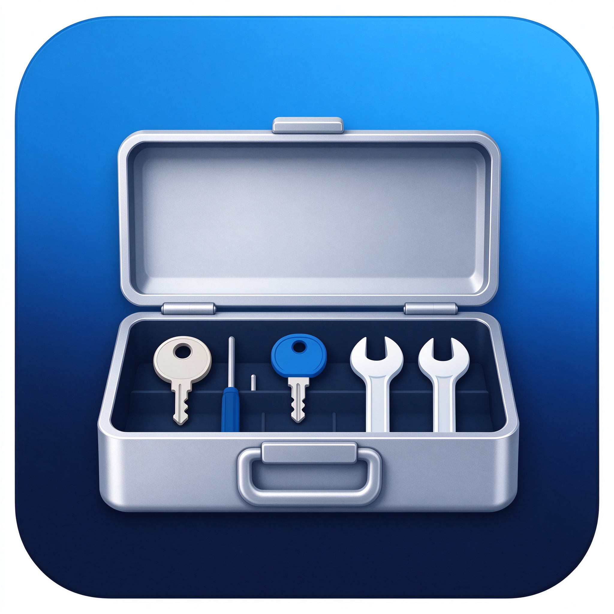

<div align="center">



# DailyKit 百宝工具箱

### 一个跨平台、完全离线、保护隐私的日常效率工具集合

**密码生成 · 二维码 · 图片压缩 · JSON 格式化 · 文本对比 · 时间戳 · 单位换算 · 哈希校验 · 番茄钟 …… 开箱即用**

[](https://github.com/DaiYiqq/DailyKit/actions/workflows/build.yml)
[](LICENSE)


</div>

---

## 📖 目录

- [为什么选择 DailyKit](#-为什么选择-dailykit)
- [功能一览](#-功能一览)
- [下载与安装](#-下载与安装)
- [安装包签名验证](#-安装包签名验证)
- [从源码运行](#-从源码运行)
- [自行打包](#-自行打包)
- [技术栈](#-技术栈)
- [社区共同维护](#-社区共同维护)
- [路线图](#-路线图)
- [开发者信息](#-开发者信息)
- [许可证](#-许可证)

---

## 💡 为什么选择 DailyKit？

你是否也遇到过这样的情况：想生成一个安全密码、压缩一张图片、格式化一段 JSON、计算文件哈希，却要在一堆广告满天飞的网页之间来回切换，还要担心输入的数据被网站记录？

**DailyKit 把这些高频小工具全部装进一个干净、快速的桌面应用：**

- 🔒 **隐私优先**：所有数据仅在你的电脑本地处理，**零网络请求**，无账号、无广告、无统计上报，开源可审计
- 📴 **完全离线**：无需联网，断网也能使用全部功能
- ⚡ **快速轻量**：原生窗口、秒级启动、占用资源少
- 💻 **全平台一致**：Windows、macOS（含 Apple 芯片）、Linux 同一份体验
- ✅ **安装包可验证**：所有安装包由 GitHub Actions 官方 CI 自动构建，并通过 **GitHub Artifact Attestations（Sigstore）** 签名，可验证未被篡改

---

## 🧰 功能一览

| 工具 | 说明 |
| --- | --- |
| 🔑 **密码生成器** | 加密安全随机源，可选字符集、长度、排除易混淆字符，实时显示密码强度与熵值，支持批量生成 |
| 🔳 **二维码生成** | 文本 / 网址 / **WiFi 一键联网**二维码，可调尺寸，导出 PNG |
| 🖼️ **图片压缩** | 本地批量压缩，调整质量、最大宽度，支持 JPEG / WebP / PNG，显示体积变化 |
| 🧩 **JSON 格式化** | 美化（2/4 空格）、压缩、校验，错误精准定位到行列 |
| 📑 **文本对比** | 逐行差异对比（LCS 算法），高亮新增与删除 |
| 🕐 **时间戳转换** | Unix 时间戳与日期互转（秒/毫秒），UTC 与本地时间 |
| 📏 **单位换算** | 长度、重量、面积、体积、温度、数据存储、速度，含市制单位 |
| 🎨 **颜色工具** | 取色器，HEX / RGB / HSL 互转，自动生成互补色与类似色 |
| 🔐 **哈希校验** | 文本 / 文件 MD5、SHA1、SHA256、SHA384、SHA512，支持校验值比对（验证下载完整性） |
| 🔤 **Base64 编解码** | 支持 Unicode 与 URL 安全变体 |
| 📝 **文本处理** | 大小写转换、行去重、排序、空白清理、字数统计 |
| 🍅 **番茄钟** | 25 分钟专注 + 5 分钟休息，每 4 个番茄自动长休息，提示音提醒 |
| ℹ️ **关于页面** | 开发者信息与社区参与方式 |

---

## ⬇️ 下载与安装

前往 **[Releases 页面](https://github.com/DaiYiqq/DailyKit/releases)** 下载对应平台的安装包。

### Windows
- 下载 `.exe` 安装程序：**64 位系统选 `x64`，32 位系统选 `ia32`**
- 双击运行，跟随**图形化安装向导**：可选择安装目录、创建桌面快捷方式
- 安装完成后从桌面或开始菜单启动 DailyKit

> 首次运行若 Windows 弹出 SmartScreen 提示，点击「更多信息」→「仍要运行」。这是因为本软件为个人开发者签名、尚未购买昂贵的 EV 代码签名证书；你可以通过下方的签名验证步骤确认安装包来源。

### macOS
- **Apple 芯片（M1/M2/M3/M4…）选 `arm64`，Intel 芯片选 `x64`**
- 下载 `.dmg`，打开后将 **DailyKit 拖入「应用程序」文件夹**
- 首次打开若提示「无法验证开发者」，请前往「系统设置 → 隐私与安全性」点击「仍要打开」

### Linux
- **AppImage**（推荐，通用）：下载后赋予执行权限即可运行
  ```bash
  chmod +x DailyKit-*.AppImage
  ./DailyKit-*.AppImage
  ```
- **Debian / Ubuntu / 深度 / UOS**：下载 `.deb` 后 `sudo dpkg -i DailyKit-*.deb`
- **Fedora / CentOS / openSUSE**：下载 `.rpm` 后 `sudo rpm -i DailyKit-*.rpm`

---

## 🔏 安装包签名验证

所有安装包均由 GitHub Actions 在三平台官方 Runner 上构建，并通过 **GitHub Artifact Attestations**（基于 Sigstore）生成**构建来源签名证明**，证明安装包确实由本仓库的官方 CI 构建、未被篡改。

### 方式一：网页查看
1. 打开对应 [Actions 构建记录](https://github.com/DaiYiqq/DailyKit/actions)
2. 在左侧或 Release 页面可以看到 **Artifacts / Attestations** 信息

### 方式二：本地命令验证
安装 [GitHub CLI](https://cli.github.com/) 后，对下载的安装包执行：

```bash
gh attestation verify DailyKit-1.0.0-win-x64.exe --repo DaiYiqq/DailyKit
```

验证通过会显示构建来源仓库为 `DaiYiqq/DailyKit` 及构建工作流信息。

---

## 🛠️ 从源码运行

需要 **Node.js 18+**（推荐 20 LTS）。

```bash
# 1. 克隆仓库
git clone https://github.com/DaiYiqq/DailyKit.git
cd DailyKit

# 2. 安装依赖
npm install

# 3. 启动应用
npm start
```

开发模式（自动打开 DevTools）：

```bash
# Windows PowerShell
$env:DAILYKIT_DEV="1"; npm start
# macOS / Linux
DAILYKIT_DEV=1 npm start
```

---

## 📦 自行打包

```bash
npm run dist:win      # 仅打包 Windows（.exe）
npm run dist:mac      # 仅打包 macOS（.dmg / .zip）
npm run dist:linux    # 仅打包 Linux（.AppImage / .deb / .rpm）
npm run dist          # 打包当前平台
```

产物输出在 `release/` 目录。

> 注意：跨平台打包受系统限制——例如在 Windows 上无法直接构建 macOS 安装包。完整的全平台安装包由 CI 在对应系统的 Runner 上构建。

---

## 🧱 技术栈

- **[Electron](https://www.electronjs.org/)** — 跨平台桌面应用框架
- **原生 HTML / CSS / JavaScript** — 无重型框架，简单、可审计、易维护
- **[qrcode](https://github.com/soldair/node-qrcode)** — 二维码生成
- **[electron-builder](https://www.electron.build/)** — 全平台安装包打包
- **GitHub Actions** — 三平台自动构建
- **GitHub Artifact Attestations / Sigstore** — 构建来源签名

### 安全架构

- `contextIsolation: true` + `nodeIntegration: false`，渲染进程不直接拥有 Node 能力
- 通过 `preload` 脚本的 `contextBridge` 仅暴露白名单 API
- 严格的 **Content-Security-Policy**，禁止加载远程脚本
- 所有外部链接由系统浏览器打开，文件操作均经主进程校验

---

## 🤝 社区共同维护

DailyKit 基于 **MIT 协议开源**，由社区共同维护，**欢迎每一位用户参与**！

### 你可以：

- 🐛 **报告 Bug**：使用 [Bug 报告模板](https://github.com/DaiYiqq/DailyKit/issues/new?template=bug_report.md)
- 💡 **提出新功能建议**：使用 [功能建议模板](https://github.com/DaiYiqq/DailyKit/issues/new?template=feature_request.md)
- 🔀 **提交 Pull Request**：修复问题、新增工具、改进文档
- 💬 **参与讨论**：在 [Discussions](https://github.com/DaiYiqq/DailyKit/discussions) 交流想法

### 贡献流程

1. Fork 本仓库
2. 新建分支：`git checkout -b feature/your-feature`
3. 提交修改：`git commit -m "feat: add your feature"`
4. 推送分支：`git push origin feature/your-feature`
5. 发起 Pull Request

详细规范请阅读 [**CONTRIBUTING.md**](CONTRIBUTING.md)，行为准则请阅读 [**CODE_OF_CONDUCT.md**](CODE_OF_CONDUCT.md)。

所有贡献者都会出现在项目的 Contributors 列表中，感谢每一位让 DailyKit 变得更好的人！🎉

---

## 🗺️ 路线图

- [x] 13+ 核心工具（v1.0.0）
- [x] 全平台安装包 + GitHub 签名
- [x] 首次启动引导与关于页面
- [ ] 应用内主题切换（深色 / 浅色）
- [ ] 多语言界面（英文）
- [ ] 剪贴板历史
- [ ] 更多工具：Markdown 预览、正则表达式测试、屏幕拾色器、PDF 工具
- [ ] 插件机制，允许社区贡献工具

欢迎在 Issues 中提出你希望看到的功能！

---

## 👨‍💻 开发者信息

**开发者：戴亿（Dai Yi）**

- 📧 **邮箱（Gmail）：** [daiy91004@gmail.com](mailto:daiy91004@gmail.com)
- 📮 **邮箱（QQ 邮箱）：** [1703205607@qq.com](mailto:1703205607@qq.com)
- 🎵 **抖音：** `daiyi091004`
- 🐧 **QQ：** `1703205607`
- 🐙 **GitHub：** [DaiYiqq](https://github.com/DaiYiqq)
- 📦 **项目仓库：** [DaiYiqq/DailyKit](https://github.com/DaiYiqq/DailyKit)

> 如有使用问题、合作意向或安全问题，欢迎通过以上任意方式联系。安全问题请优先使用邮箱私下报告，参见 [SECURITY.md](SECURITY.md)。

---

## 📄 许可证

本项目基于 **[MIT License](LICENSE)** 开源，可自由使用、修改、分发，唯请保留原始版权声明。

```
MIT License

Copyright (c) 2026 戴亿 (Dai Yi)

Permission is hereby granted, free of charge, to any person obtaining a copy
of this software and associated documentation files (the "Software"), to deal
in the Software without restriction, including without limitation the rights
to use, copy, modify, merge, publish, distribute, sublicense, and/or sell
copies of the Software, and to permit persons to whom the Software is
furnished to do so, subject to the following conditions:

The above copyright notice and this permission notice shall be included in all
copies or substantial portions of the Software.

THE SOFTWARE IS PROVIDED "AS IS", WITHOUT WARRANTY OF ANY KIND, EXPRESS OR
IMPLIED, INCLUDING BUT NOT LIMITED TO THE WARRANTIES OF MERCHANTABILITY,
FITNESS FOR A PARTICULAR PURPOSE AND NONINFRINGEMENT. IN NO EVENT SHALL THE
AUTHORS OR COPYRIGHT HOLDERS BE LIABLE FOR ANY CLAIM, DAMAGES OR OTHER
LIABILITY, WHETHER IN AN ACTION OF CONTRACT, TORT OR OTHERWISE, ARISING FROM,
OUT OF OR IN CONNECTION WITH THE SOFTWARE OR THE USE OR OTHER DEALINGS IN THE
SOFTWARE.
```

---

<div align="center">

**⭐ 如果 DailyKit 对你有帮助，欢迎点亮 Star，这是对开发者最大的鼓励！**

Made with ❤️ by **戴亿（Dai Yi）** · Community maintained

</div>
